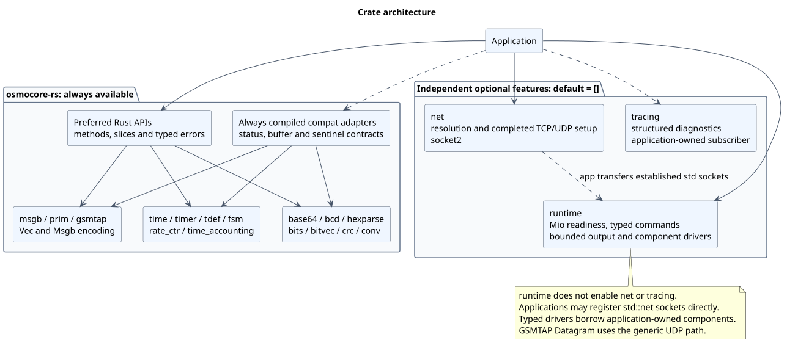
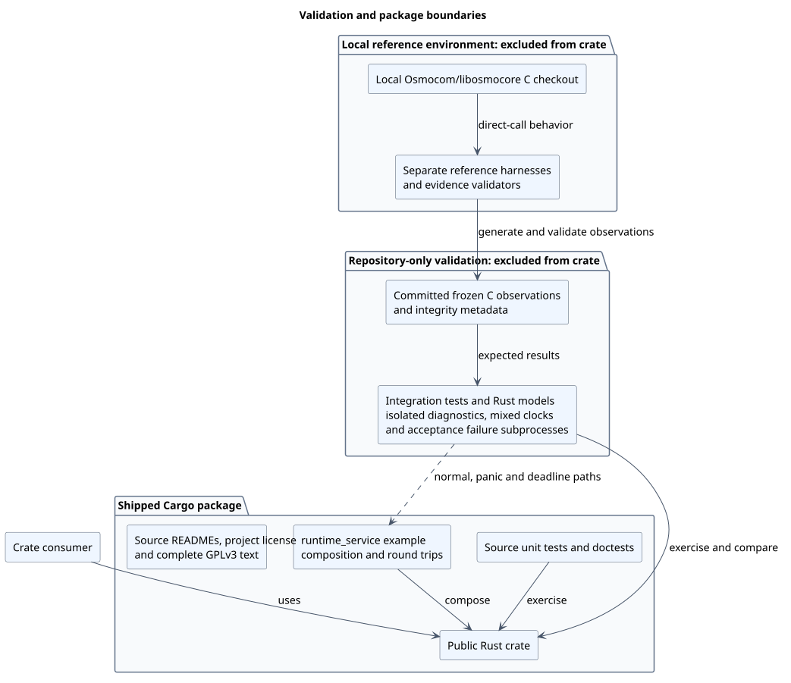
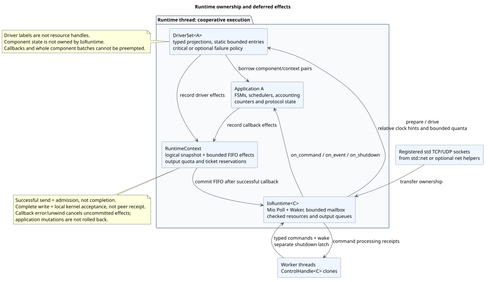
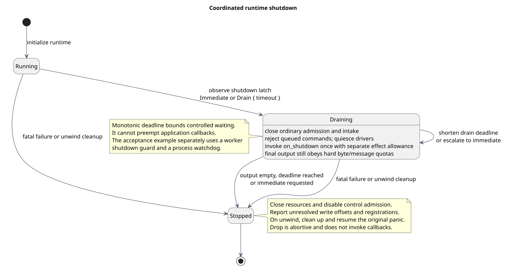
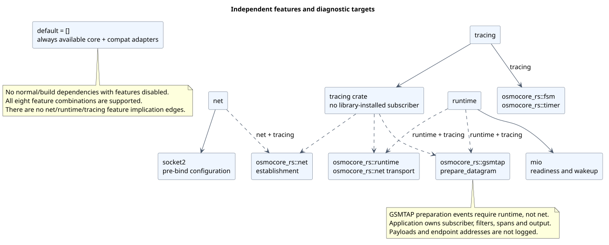
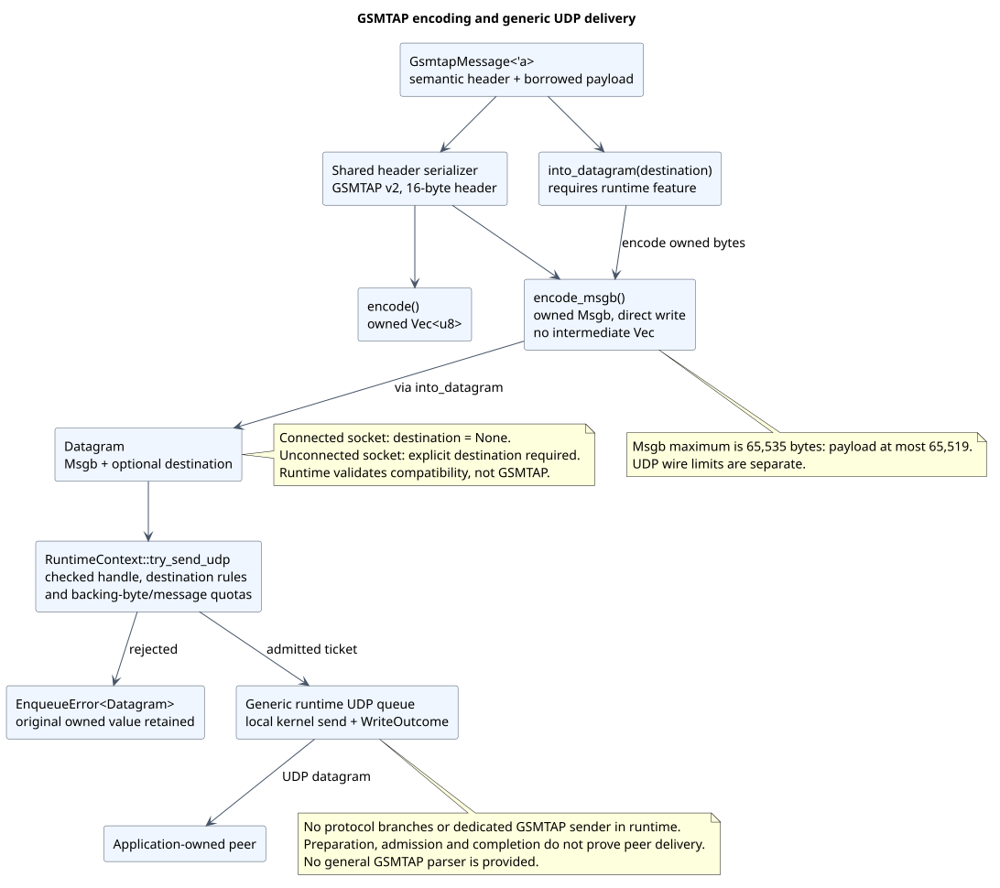
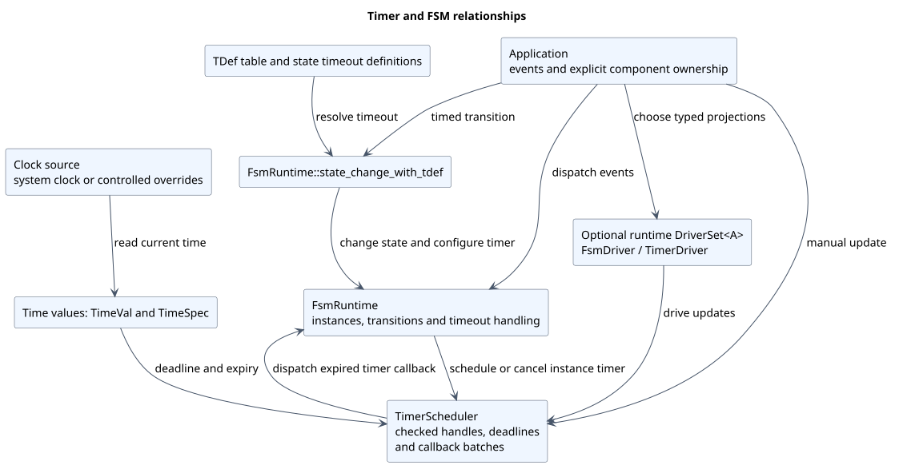
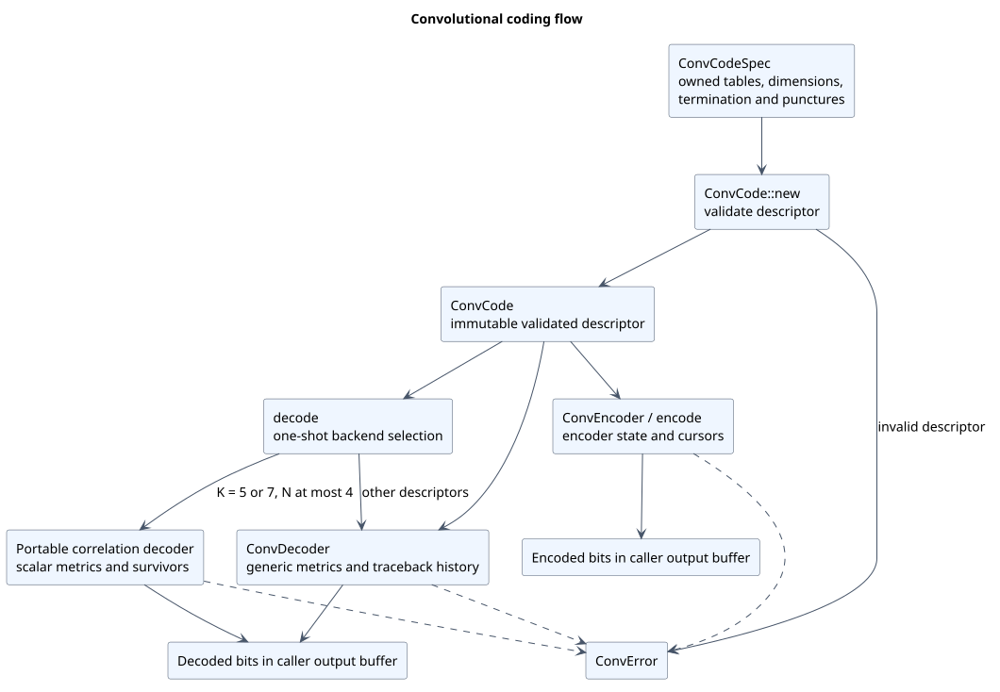

# Architecture and compatibility

This guide describes crate organization, ownership, feature selection, runtime
behavior and the supported libosmocore compatibility boundary. API contracts and
runnable examples remain in module Rustdoc and the subsystem source guides.

- [Architecture overview](#architecture-overview)
- [Runtime and lifecycle](#runtime-and-lifecycle)
- [Networking establishment](#networking-establishment)
- [Features and structured diagnostics](#features-and-structured-diagnostics)
- [GSMTAP encoding and runtime delivery](#gsmtap-encoding-and-runtime-delivery)
- [Timing, FSMs, accounting and counters](#timing-fsms-accounting-and-counters)
- [Convolutional coding](#convolutional-coding)
- [Compatibility status](#compatibility-status)
- [Architecture diagrams](#architecture-diagrams)
- [API and development](#api-and-development)

## Architecture overview

### Crate organization

Functional modules are public at the crate root. Applications use preferred
Rust APIs or always-compiled `compat::<subsystem>` adapters for selected observed
C contracts. Both interfaces share functional implementations and owned types;
modules grouped in the diagram are families, not a dependency chain.



[Diagram source](architecture/diagrams/src/crate-architecture.puml)

| Area | Design and contracts |
| --- | --- |
| Encoding and coding | Slice-based conversions, CRC and [convolutional coding](#convolutional-coding) |
| Messages | Owned Msgb storage, primitive metadata and [GSMTAP encoding/delivery](#gsmtap-encoding-and-runtime-delivery) |
| Components | Explicit clocks/schedulers, [FSMs, accounting and rate counters](#timing-fsms-accounting-and-counters) |
| Socket establishment | Optional [net helpers](#networking-establishment) return owned standard sockets |
| I/O and lifecycle | Independent [runtime](#runtime-and-lifecycle) drives readiness, typed commands, deferred effects and component projections |
| Observation | Independent [features and diagnostics](#features-and-structured-diagnostics) with application-owned subscribers |

The [source overview](../osmocore-rs/src/README.md) links precise API contracts
and source locations. Default features are empty; net, runtime and tracing select
independently.

### Ownership and compatibility

Applications use methods on owned Msgb, FsmRuntime, TimerScheduler and
RateCtrRuntime values; BitVec borrows caller-owned storage. Msgb tracks explicit
headroom, live data, tailroom and layer positions. Primitive metadata borrows an
optional message. GSMTAP semantic input borrows payload bytes; encoded output
owns its storage.

Clocks, component context and scheduling are explicit. Checked resource handles
reject foreign owners and stale lifetimes. The optional I/O runtime owns socket
resources and mailbox plumbing; applications retain protocol/component state.
Callbacks collect bounded effects rather than mutating the live resource table.
There is no implicit global runtime.

Compatibility adapters retain selected integer-status, output-buffer,
signed-length, sentinel and conformance-inspection contracts. They are safe Rust
interfaces with no C ABI, layout or allocator-parity promise. The
[compatibility status](#compatibility-status) records supported
families, safety differences and intentional exclusions.

### Validation and package boundaries



[Diagram source](architecture/diagrams/src/validation-boundary.puml)

Source unit tests and runnable Rustdoc examples ship with the crate, together
with source/module guides, licensing material and the runtime acceptance example.
The package builds without the C checkout, sibling harness project or repository
integration fixtures. Repository architecture docs and the root changelog remain
outside the crate's source-oriented package boundary.

Repository integration tests replay frozen observations and exercise independent
Rust models, cross-module consumers, mixed clocks and isolated diagnostics.
The shipped runtime example demonstrates composition and round trips; focused
tests separately establish accounting, catch-up, partial output and drain timeout.
Its normal, worker-panic and process-deadline paths have subprocess coverage.

Separate reference harnesses generate and validate observations from the required
local Osmocom/libosmocore checkout. Ordinary repository tests replay committed
evidence without building C; expected C results are never generated by Rust.
Reference tooling, integration evidence and local ignored archives are excluded
from the package. Claims remain bounded by documented source, ABI and backend
scope. The [test guide](../osmocore-rs/tests/README.md) contains fixture and
regeneration procedures.

### Support scope

Initial validated platform: Linux x86_64. Rust edition: 2024. Toolchain policy:
current stable. MSRV: not declared. Broader runtime portability is not validated.
Pending TCP connect, SCTP/TLS, async runtime integration, native C select/timerfd
compatibility, exporters, VTY/CTRL, supervision, a general GSMTAP parser and full
libosmocore parity remain intentionally excluded.

## Runtime and lifecycle

The independent `runtime` feature supplies synchronous Mio execution, bounded
TCP/UDP output, typed component drivers, typed cross-thread commands and
coordinated shutdown. Component and protocol state remain application-owned.
Default features are empty.

### Ownership and effects



[Diagram source](architecture/diagrams/src/runtime-ownership.puml)

1. `runtime = ["dep:mio"]` is independent of net/socket2 and tracing. Registration
   consumes established standard-library sockets. A separately feature-gated test
   composes existing net helpers without changing their establishment contracts.
2. `Application::Command: Send + 'static` supplies application-defined typed
   commands, including typed reply channels and transferred completed sockets.
   There is no numeric notification/Msgb command protocol. Application state,
   errors, component contexts and FSM payloads gain no Send/Sync/Debug requirement.
3. `RuntimeContext` has a logical snapshot and bounded FIFO effect outbox, without
   socket or resource-table access. Callbacks reserve quota and IDs; the runtime
   applies registration, closure, pause/resume, send and shutdown effects only
   after successful return. Error/unwind cancels uncommitted effects; application
   mutations remain inspectable.
4. The application owns a static bounded `DriverSet<A>` with typed projections.
   Optional failures disable private entries and retain their original error for
   `take_failures`. Labels and internal rotation indexes supply identity; no
   public I/O driver handle exists.

`IoRuntime<C>` only parameterizes its mailbox by command type. Its nongeneric
private core owns Poll/backend, checked resource slots, monotonically allocated
private registration tokens, queues, admission accounting and lifecycle. Application
FSMs, schedulers, counters/accounting and protocol state remain application-owned.
Both runtime and driver set enforce thread confinement with Rc markers. Only
control/mailbox plumbing and checked handles cross threads. Independent runtimes
reject each other's handles.

The public surface comprises Application, IoRuntime, RuntimeContext, checked
TCP/UDP/listener handles, write/registration tickets, RuntimeEvent, resource
options, typed errors, QueueUsage, DriverSet/RuntimeDriver and typed timer/FSM/
accounting/rate adapters. Full contracts/defaults and a runnable API example are
in [the runtime guide](../osmocore-rs/src/runtime/README.md).

### Output, effects, readiness and scheduling

Per-resource/global backing-byte and message limits include callback reservations.
Msgb charges its entire backing until release, even after a partial write.
`queue_usage()` distinguishes retained bytes, outstanding message credits and
remaining wire bytes. Completion bookkeeping retains message credits until
notification delivery; empty messages cannot bypass the limit. Rejection returns
the original owned value. Close-then-send rejects; send-then-close cancels the
reserved ticket explicitly. Normal notifications and effects have separate count
bounds. The shutdown hook has a separate effect allowance and reserved outcome
space, while hard output quotas remain in force.

TCP queues retain FIFO offsets through short writes, WouldBlock and budget yields.
Empty TCP messages skip I/O; WriteZero fails the connection. EOF has a separate
event and preserves accepted output; default closure follows flush, with explicit
write-half retention. UDP preserves boundaries, source addresses and empty
packets. Oversize receives use max-size-plus-one scratch and are discarded with
notification. Connected versus explicit destinations are checked. A short UDP
send fails its packet; ordinary send failures allow later datagrams to progress.
Successful admission reserves a write ticket; it does not perform an OS write.
Only a later `WriteStatus::Complete` means local kernel acceptance, never peer
receipt. Command receipts separately report command callback processing.

Resource/direction continuations are deduplicated and retained when a quantum
expires. Resume schedules an attempt without requiring another kernel edge.
Interest-free registrations suspend; resumption gets a fresh token. Delayed tokens
cannot address replacements. Listeners suspend at the resource cap and resume
when capacity returns. Accepted streams start paused for application setup; Mio
provides nonblocking accept and nodelay is applied explicitly. Resource iteration
revalidates checked keys after callbacks, including removal of self/other resources.

Commands, drivers, resources and notifications use bounded work quanta; drivers
and resources rotate. Normal notification allowance carries across the whole
step. TCP read/write directions have individual call/byte quanta; UDP packets are
indivisible. Driver hints are relative to each component's own clock and refreshed
before blocking. Existing update calls remain authoritative, including rechecks
that surface deferred errors or backward monotonic-clock failures before a future
deadline. Sentinel/raw waits recheck at the finite poll cap. TimeCc retains its
existing monotonic accounting and wall-clock scheduler split. Rate-counter phase
and catch-up retain their existing semantics; `next_deadline()` exposes the
stored deadline without driving rollups.

### Cross-thread control

A bounded std sync_channel and one shared Mio Waker carry typed commands.
Submission/admission/shutdown ordering uses a short-held mutex. An out-of-band
latch bypasses full mailboxes. Enqueue precedes wake; a post-enqueue wake failure
returns the queued receipt plus its error. The 250 ms default poll cap supplies
fallback. Queued commands are checked each turn, including after polling; wake
coalescing cannot strand them. Receipt delivery is nonblocking and resolves as
processed, rejected or failed, including unwind. Callers can poll or wait; blocking
waits belong off the runtime thread. Opaque command heaps remain application
policy: mailbox count is not a transitive command-memory bound.

### Shutdown lifecycle



[Diagram source](architecture/diagrams/src/runtime-lifecycle.puml)

Running becomes Draining, invokes one bounded final-output hook, quiesces automatic
drivers and drains accepted output against an Instant deadline, then stops.
Requests shorten or escalate; they never extend a drain. Intake/ordinary admission
close at shutdown. Immediate stop, timeout and fatal poll failure close I/O and
report unresolved writes with partial offsets and undelivered registration results.
Controls disable before the poller drops. Drop is abortive without callbacks.
Application errors stop; resource-local I/O/interest failures retain their original
source; critical driver errors retain their original value. Panics clean up and
resume unwinding. Existing application mutations are inspectable afterward.

Optional tracing uses runtime and network targets with structured scheduling,
queue, resource identity, driver label, write progress and lifecycle fields.
Saturation warnings describe transitions. Command/write callback spans propagate
from submission. Neither command/payload content, arbitrary app errors, pointers
nor raw descriptors are logged. Subscriber, filter and output remain app-owned.
Runtime diagnostics tests use an isolated executable to avoid scoped-subscriber
callsite interest-cache races.

### Support and limits

Validation is 64-bit Linux with the installed stable compiler, not a platform
certification or a declared MSRV. Other platforms, exhaustive OS error injection,
all possible concurrent schedules and large-scale performance/latency workloads
are not certified by this suite. Kernel short-write sizes are not assumed by the
scripted coverage. App callbacks and whole existing timer/rate batches are
cooperative and cannot be preempted; shutdown timeout bounds controlled waiting,
not arbitrary callback duration. Command payload memory remains app policy.

Pending connect, async/Tokio, TLS/SCTP, reconnection, protocol framing frameworks,
signals, supervision, worker topology and exporters remain deferred/application
policy. Initial validated platform: Linux x86_64. Rust edition 2024, current stable
toolchain, no declared MSRV.

### Acceptance evidence

`examples/runtime_service.rs` is an end-to-end composition and round-trip
acceptance example. It asserts bounded application framing, TCP/UDP replies,
FSM timer activity, request counts, typed command processing, two local write
completions and clean shutdown. Accounting and rate drivers are registered as
composition evidence. TCP writes may coalesce into one read callback.
It does not assert accounting totals, rollup deadlines or output pending at shutdown.

Focused behavioral evidence lives in:

- [Mixed-clock runtime tests](../osmocore-rs/tests/runtime/mixed_drivers.rs): rate catch-up across wall-clock changes.
- [Accounting consumer](../osmocore-rs/tests/time/consumers.rs): cumulative totals and counter history.
- [Scripted TCP output](../osmocore-rs/src/runtime/output.rs): short writes, interruption and FIFO offsets.
- [Runtime core tests](../osmocore-rs/src/runtime/core.rs): partial-output drain timeout and final hook.
- [GSMTAP runtime tests](../osmocore-rs/tests/gsmtap/runtime_integration.rs): wire delivery, destination rules and rejection ownership.

The worker owns a shutdown guard that requests drain on return or unwind. A
10-second process watchdog bounds the whole standalone scenario even if runtime
callbacks stop cooperating. `--worker-panic` injects an assertion failure;
`--deadline-probe` deliberately parks the worker and exercises a 200 ms watchdog.
Both failure modes run in bounded subprocess tests; a worker panic must show
runtime shutdown before the original failure is propagated. The watchdog reports
a deadline failure and exits with status 2. These bounds belong to acceptance
orchestration, not the runtime's cooperative callback contract.

The [diagnostics architecture](#features-and-targets) explains feature
gates and observation targets. The runtime does not enable net or tracing.

## Networking establishment

### Architecture and public API

Optional feature `net` exposes `net::{resolve, listen_tcp, connect_tcp, bind_udp}`,
`AddressFamily`, `SocketOptions`, `TcpOptions`, `NetError` and `Operation`.
Defaults remain empty; `net` and `tracing` are independent.

The layer composes standard Rust endpoints/resolution/socket ownership with
socket2 pre-bind configuration. TCP supports listener creation, caller-selected
local source binding, an explicit nonzero per-attempt connect timeout and a
completed connection returned in the requested blocking/nonblocking mode. UDP
supports local bind and an optional default peer. Reuse, IPv6-only mode and DSCP
are explicit; TCP_NODELAY and SO_KEEPALIVE are configurable. Requested settings
fail visibly rather than being silently ignored. Original I/O errors and OS codes
are retained with their establishment phase. Every partial socket closes through
RAII on failure. No implicit DNS, candidate retry/family-selection policy, global
runtime, worker thread, readiness registry, accept loop or shutdown policy exists.

Applications receive standard `TcpListener`, `TcpStream` or `UdpSocket` values
and own their I/O/runtime integration. DNS resolution is separately synchronous
and OS-controlled; the TCP timeout does not cover DNS or application I/O. There
is no pending/in-progress TCP connection API in this subset. Accepted-stream
option and mode inheritance is OS-defined.

The [public networking contract](../osmocore-rs/src/net/README.md) provides examples,
configuration/error rules, platform limits and detailed C capability mapping.

### Diagnostics and dependency impact

With both features enabled, `osmocore_rs::net` emits trace-level establishment
spans, debug-level successful resolution/socket establishment and warn-level
failures. Stable operations are `resolve`, `tcp_listen`, `tcp_connect`, `udp_bind`.
Fields include operation, family, nonblocking mode, address count, failing phase,
error category and optional numeric OS error. Active application spans are
inherited. Hostnames, endpoints, payloads and error-message strings are omitted.
Applications retain subscriber/filter/output ownership; no subscriber is installed.

Initial validated platform: Linux x86_64; edition 2024, current stable Rust,
no declared MSRV. `net`, `runtime` and `tracing` select independently with empty
defaults. See [runtime architecture](#runtime-and-lifecycle) for transferring established
standard sockets to readiness execution, and [diagnostics](#features-and-structured-diagnostics) for
feature and target selection.

## Features and structured diagnostics

### Features and targets

Default features are empty. `net`, `runtime` and `tracing` select independently;
all eight combinations are supported. Compatibility adapters are always compiled.
`net` selects socket2 for establishment; `runtime` selects Mio for readiness.
Neither feature enables the other or tracing. With features disabled there are
no normal/build dependencies.



[Diagram source](architecture/diagrams/src/features-diagnostics.puml)

Solid dependency arrows select libraries; dashed arrows show diagnostic target
availability with the indicated combination. Target names do not imply Cargo
feature selection: runtime transport emits `osmocore_rs::net` events even without
the `net` feature.

| Target | Required features | Observed work |
| --- | --- | --- |
| `osmocore_rs::fsm` | `tracing` | FSM dispatch, transitions, hierarchy and lifecycle |
| `osmocore_rs::timer` | `tracing` | Arm, cancel, release, expiry and callback execution |
| `osmocore_rs::net` | `net,tracing` or `runtime,tracing` | Establishment with net; transport with runtime |
| `osmocore_rs::runtime` | `runtime,tracing` | Resource, command, queue, driver and shutdown operations |
| `osmocore_rs::gsmtap` | `runtime,tracing` | Successful Datagram preparation metadata |

### Subscriber ownership and context

Applications configure subscribers, filters, formatting and output destinations.
The library installs no subscriber and introduces no public logger handle or
application payload bound. Disabled instrumentation evaluates no diagnostic
fields and retains no span context.

Trace-level spans preserve nested application context. Successful timer arms
retain their active span until replacement, cancellation, release or expiry.
Expiry enters that context and a callback span; callback re-arming owns its new
activation independently. Runtime command and write callbacks retain the
submission context. Context propagation assumes the same subscriber is used for
scheduling/submission and dispatch; contexts do not migrate between independent
subscribers.

Debug covers ordinary lifecycle operations. Warnings describe rejected operations,
saturation transitions and recoverable failures; errors cover fatal runtime or
existing caught-panic boundaries. Numeric identities and event/state fields do
not require application Debug implementations. Instance-private values, payloads,
commands, endpoint addresses, raw descriptors and arbitrary application errors
are omitted. The [public diagnostics contract](../osmocore-rs/src/diagnostics/README.md)
and [runtime contract](../osmocore-rs/src/runtime/README.md) define exact fields,
levels, operation names and context limits.

### Diagnostic test isolation

Scoped subscriber tests run in isolated executables under their owning subsystem.
In tracing-core 0.1.36, the single-dispatcher callsite optimization uses the first
registering thread's default dispatcher. Unsubscribed first use can cache
`Interest::never` process-wide despite a subscriber on another thread, suppressing
capture until an interest rebuild. Keeping diagnostic executables separate from
uninstrumented component consumers prevents that interference without changing
production timer dispatch. Applications should configure subscribers at startup.

Specialized sinks, C global logging infrastructure, category-query APIs,
VTY configuration and remote exporters remain outside scope.

## GSMTAP encoding and runtime delivery

### Encoding and ownership



[Diagram source](architecture/diagrams/src/gsmtap-delivery.puml)

`gsmtap/mod.rs` exports wire constants and `GsmtapMessage` and includes its
public guide in Rustdoc.
`gsmtap/message.rs` owns semantic input and its Vec, Msgb and runtime conversions.
`gsmtap/encode.rs` owns a single header serializer and direct Vec/Msgb writes.
The runtime conversion stays with the semantic message methods.

Dependency direction is GSMTAP → Msgb, and optionally GSMTAP → runtime's generic
Datagram. The runtime contains no GSMTAP branches.
Networking remains a separate optional socket-establishment capability.

### Public API and error behavior

`GsmtapMessage::um()` supplies UM defaults; `encode() -> Vec<u8>` returns owned
wire bytes. Owned-buffer and runtime conversions are:

```rust
pub fn encode_msgb(self) -> Result<Msgb, MsgbError>;
#[cfg(feature = "runtime")]
pub fn into_datagram(self, destination: Option<SocketAddr>)
    -> Result<Datagram, MsgbError>;
```

Encoding fills newly allocated Msgb storage directly, without an intermediate
Vec. Header and payload occupy the entire live
region, with no headroom or tailroom. Encoded bytes outlive the borrowed input.

The Msgb capacity limit is 65,535 bytes: **65,519 payload bytes succeed;
65,520 fail with `MsgbError::CapacityTooLarge`**. Vec encoding still accepts
65,520 payload bytes, producing 65,536 bytes. Capacity is distinct from UDP's
wire-size limit. Allocation failure follows existing Rust Vec/Msgb behavior;
this API does not claim recoverable allocator-failure handling.

### Compatibility

The two positional compatibility constructors live in
`src/compat/gsmtap.rs` and delegate to `GsmtapMessage::encode()`. Both
compatibility paths and the preferred Vec/Msgb paths are checked against all
seven committed C observations. The v2 version, 16-byte header, endian order,
signed field representation, UM defaults and fixed zero antenna/reserved bytes
are checked byte-for-byte.

### Runtime integration

`message.into_datagram(destination)` creates a generic Datagram holding the
encoded Msgb. Applications enqueue it through the existing
`RuntimeContext::try_send_udp(handle, datagram)` callback API.

`None` means **no explicit destination**; `Some(address)` supplies one. GSMTAP
performs no socket-state or destination-compatibility validation. The generic
runtime requires no explicit destination for connected resources and an explicit
destination for unconnected resources, rejecting incompatible requests with
`Rejection::InvalidDestination`. Enqueue errors remain
`EnqueueError<Datagram>` and preserve owned bytes and destination for retry.

Sockets can come from std::net or, with `net`, `net::bind_udp`. Tests exercise
both setup paths across feature configurations. Preparation/acceptance does
not imply successful send or peer delivery. Empty GSMTAP payloads produce a
16-byte datagram. The public guide includes a runnable callback/runtime example.

### Diagnostics

One successful-preparation event is emitted at **trace**, under
`osmocore_rs::gsmtap`, with these fields:

- `operation = "prepare_datagram"`
- `message_type`, `arfcn`, `timeslot`, `channel_type`, `frame_number`
- `payload_len`, `explicit_destination` (boolean)

The event inherits the application span. Plain Vec/Msgb encoding and failed
preparation emit no GSMTAP event. It records preparation, not enqueue or send
completion. No payload/packet bytes, endpoint addresses or pointers are logged.
The library installs no subscriber; disabled tracing removes instrumentation.
An isolated diagnostics executable verifies fields, privacy and trace filtering.

### Feature impact

| Capability | Required features |
| --- | --- |
| Vec/Msgb encoding, UM convenience, constants, compatibility constructors | None |
| `into_datagram` | `runtime` |
| Optional socket setup through `net::bind_udp` | `net` |
| GSMTAP preparation events | `runtime` and `tracing` |

Feature selection is independent; see [diagnostics and feature gates](#features-and-structured-diagnostics).

### Scope boundaries

Parsing/decoding, malformed-packet taxonomy, extra header inputs, builders,
protocol-specific sinks, SCTP, runtime redesign, protocol frameworks and metrics
exporters remain outside scope. General GSMTAP parsing is not provided.


The [GSMTAP module contract](../osmocore-rs/src/gsmtap/README.md) includes a
runnable callback/runtime example.

## Timing, FSMs, accounting and counters

### Clocks and scheduler ownership

`time` supplies clock values, sources and overrides. `TimerScheduler` owns
scheduled callbacks, deadlines and checked handles; the application owns both
the scheduler and callback context. Selection, callback batches, mutation and
reentrancy follow explicit rules. Scheduler updates read their clock source;
there is no implicit process-wide event loop.

### FSM and timeout definitions



[Diagram source](architecture/diagrams/src/timer-fsm.puml)

`FsmRuntime` owns definitions, registration and instances, including hierarchy,
state transitions, dispatch and termination. Timer-aware methods receive an
explicit scheduler. `tdef` supplies timeout definitions and unit conversion;
`state_change_with_tdef` resolves the table entry before configuring the timed
state change. Scheduler expiry invokes the instance's timer callback.

The diagram shows calls and data, not ownership transfer. Applications can drive
updates manually or explicitly attach typed `TimerDriver`/`FsmDriver` projections
to the optional [I/O runtime](#runtime-and-lifecycle). Both use existing update boundaries
and preserve application ownership. Native C select/timerfd compatibility is
outside scope.

### Accounting and counters

`time_accounting` separates event transitions, policy resolution and effects.
An optional `CounterSink`, including `RateCtr`, receives cumulative increments.
Accounting uses monotonic elapsed time with wall-clock scheduler wakeups; those
clock roles remain distinct when driven by the runtime.

`RateCtr` holds arithmetic and interval state. `RateCtrRuntime` owns groups,
lookup/iteration and registry behavior. The periodic monotonic driver preserves
phase and catches up missed second/minute/hour/day rollups. Native C
`rate_ctr_init()` and select/timerfd initialization are reference evidence only.

Each runtime adapter computes relative waits using its component's own clock;
existing update methods decide what is due. Whole timer batches and rate catch-up
are cooperative calls and cannot be preempted by the runtime.

See [time and timing contracts](../osmocore-rs/src/time/README.md),
[FSM contracts](../osmocore-rs/src/fsm/README.md) and
[rate counter contracts](../osmocore-rs/src/rate_ctr/README.md) for precise
mutation, callback, clock-error and compatibility semantics.

## Convolutional coding

Checked `ConvCodeSpec`/`ConvCode` descriptors feed an encoder, generic stateful
decoder or portable scalar correlation decoder. Each path owns its working
state and checks dimensions, capacities and arithmetic.



[Diagram source](architecture/diagrams/src/convolutional-coding.puml)

A validated descriptor supplies the encoder and decoding paths. Operation-specific
checks still apply after descriptor validation. Encoder and stateful decoder
instances borrow the validated descriptor; input/output slices remain caller-owned.
Capacity, arithmetic, termination and backend support can reject an operation.

Generic squared-error metrics and correlation status results have distinct
contracts. One-shot dispatch chooses correlation for K = 5 or 7 with N at most 4;
that route rejects unsupported cases, including N = 1, without generic fallback.
Other descriptors use the generic decoder. Correlation is portable scalar code;
the diagram does not imply CPU-specific SIMD or NEON implementation parity.

The [coding contract](../osmocore-rs/src/conv/README.md) documents termination,
punctures, backend evidence and supported domains. Other conversion and CRC
families are covered by the [source overview](../osmocore-rs/src/README.md).

## Compatibility status

`osmocore-rs` implements selected telecom and core utility contracts with
Rust-native APIs. It is not a replacement for every Osmocom/libosmocore API,
and exports no C ABI. This status describes the 0.1.0 scope.

### Development approach

`osmocore-rs` is an idiomatic Rust implementation of selected libosmocore
behavior, not a line-by-line translation of its C source.

1. **Recorded outputs define behavior.** Direct-call C harnesses in the separate
   `gsmtap-rs` project call public libosmocore APIs from an unmodified local
   checkout and record return values, buffer contents, deadlines and callback
   traces. Thousands of these observations, committed under
   `osmocore-rs/tests/compatibility/vectors/`, specify what each Rust API must
   reproduce. Rust never generates expected results.
2. **The C source is consulted to understand behavior.** Upstream source,
   headers and tests were read to explain observed results, find boundary cases
   worth recording, and decide which behavior can and should carry over to Rust.
   Process-global state, talloc ownership, raw pointers and undefined behavior,
   for example, do not.
3. **Logic is designed for Rust.** Implementations use owned types, checked
   handles, typed errors and explicit clocks, and are verified against the
   recorded observations. Upstream C code and comments are not copied into the
   crate. Exact values are reproduced only where compatibility requires them,
   such as protocol constants and identifier character sets; lookup tables such
   as CRC tables are generated from their defining parameters.

Where Rust emulates C behavior, the subsystem guides document the contract;
where it deliberately differs, they record the Rust safety difference.

### Supported families

| Family | Supported scope | Boundary |
| --- | --- | --- |
| Base64, BCD, hexadecimal | Slice and owned conversions, selected buffer/status adapters | Owned outputs omit C terminators; BCD string inputs reject embedded NUL |
| Bits and bit vectors | Packed/unpacked conversion, cursor/field operations, borrowed storage | Rust checks capacities and invalid storage; selected partial-write behavior is retained |
| CRC | Byte CRC-16/CCITT and generic 8/16/32/64-bit CRCs | Full-width positive-input CRC-32/64 has independent Rust safety tests rather than undefined C-shift parity |
| Convolutional coding | Checked descriptors, encoder, generic stateful decoder, portable correlation and one-shot dispatch | Bounded descriptor/backend coverage; no NEON or native SIMD implementation parity claim |
| Message buffers and primitives | Owned buffers, layer helpers, resize/copy, queues, formatting and primitive metadata | No talloc contexts, pointer/layout or allocator-failure parity |
| Time, timers and TDef | Clock values/overrides, explicit scheduler, timeout tables and FSM bridge | No general native select/timerfd integration; nested scheduler updates follow the documented Rust policy |
| FSM | Owned registry/runtime, dispatch, transitions, hierarchy, termination and timeouts | No process-global C registry or logging infrastructure |
| Rate counters | Arithmetic, groups/registry, interval rollups and portable monotonic driver | Native `rate_ctr_init()`/select/timerfd behavior is reference evidence only |
| Time accounting | Event-driven cumulative accounting, policy resolution and optional counter sink | Explicit configuration and owned state replace global C machinery |
| Networking | Optional IPv4/IPv6 resolution, TCP/UDP establishment, local bind/connect, pre-bind reuse/IPv6-only/DSCP and returned nonblocking sockets | Synchronous bounded TCP connect; reactor is a separate runtime feature; no pending-connect API, SCTP or Unix-domain abstraction |
| Runtime | Optional synchronous Mio readiness, bounded TCP/UDP output, typed commands/drivers and coordinated shutdown | No pending connect, async integration, TLS/SCTP, supervision or C select/timerfd compatibility |
| GSMTAP | GSMTAP v2 Vec/Msgb encoding, UM defaults and Datagram delivery through generic UDP runtime | No general parser or protocol-specific C-style sender API |

The [source overview](../osmocore-rs/src/README.md) and its subsystem
guides specify individual contracts, mutation behavior and Rust safety differences.
Preferred APIs use owned types and typed errors. `compat::<subsystem>` exposes
selected integer-status, sentinel, signed-length and terminated-buffer contracts
as safe Rust adapters. These are always compiled, not an optional Cargo feature.

### Unsupported families

The initial scope excludes `stat_item`, separate `osmo_counter` APIs, generic
stats reporters, VTY/CTRL, native C select/timerfd and I/O backends, specialized socket
families/options beyond the bounded IP setup layer, and process-wide logging. Other unimplemented families include
application initialization, backtraces, bit compression, execution, HDLC,
intrusive queues, netdev/netns/tun, plugins, PRBS, serial/soft UART, signals,
string ring buffers and C thread/write-queue APIs. The generic runtime supplies
its own bounded output queues. General string and
numeric utilities beyond the selected conversions also remain outside scope.

These gaps describe boundaries and potential future work, without promising
that every upstream family will be implemented.

### Validation limits

Selected behavior was validated against historical Osmocom/libosmocore
reference implementations. Recorded observations are bounded by their source,
build, backend and ABI context; they do not certify every upstream declaration
or every platform. Initial validated platform: Linux x86_64. Rust edition: 2024. Toolchain policy:
current stable. MSRV: not declared. Broader portability is not validated.
Some parity claims are limited to recorded 64-bit Linux behavior. Convolutional scalar/SSE/AVX observations are documented separately
from linked-binary evidence; NEON was not executed.

Compatibility claims apply only to the documented APIs and recorded test
domains. They do not imply complete coverage of upstream headers, macros,
inline APIs, conditional declarations or every platform. The
[test guide](../osmocore-rs/tests/README.md) describes fixture integrity,
reference validation and regeneration.
The crate builds and its source unit tests run without the local C reference,
sibling tooling or repository evidence fixtures.

### Shared diagnostics capability

The optional `tracing` feature provides Rust-native structured diagnostics for
FSM, timer, runtime, network and GSMTAP preparation operations. Applications select the subscriber, filters and
output. See the [contract](../osmocore-rs/src/diagnostics/README.md). The [runtime/lifecycle guide](#runtime-and-lifecycle) describes synchronous
readiness and coordinated drain. C process-global
logging infrastructure remains outside the supported compatibility surface.

Deferred logging capability: specialized sinks, category metadata query APIs,
VTY logging configuration and remote logging targets.

### Networking establishment capability

The optional `net` feature completes the bounded establishment slice using
standard Rust endpoint/socket ownership and socket2 configuration. The
[networking contract](../osmocore-rs/src/net/README.md) maps useful C capabilities,
deliberate differences, six normalized direct-C observations and independent
loopback/error/cleanup tests. Multicast setup abstractions, Unix/raw sockets,
SCTP and pending connections remain deferred. Runtime composition is separately
available through the independent `runtime` feature. This is not
C source-file/API parity or a release-readiness claim.

Defaults are empty. `tracing`, `net` and `runtime` select independently.
Pending TCP connect, SCTP/TLS, async integration, native C select/timerfd,
exporters, VTY/CTRL, supervision, general GSMTAP parsing and full libosmocore
parity remain intentionally excluded.

## Architecture diagrams

Diagrams are embedded in the sections above. Editable PlantUML sources live in
`architecture/diagrams/src/`; rendered SVGs live in
`architecture/diagrams/generated/`.

| Topic and explanation | Rendered SVG | PlantUML source |
| --- | --- | --- |
| [Crate organization](#crate-organization) | [SVG](architecture/diagrams/generated/crate-architecture.svg) | [Source](architecture/diagrams/src/crate-architecture.puml) |
| [Runtime ownership/effects](#ownership-and-effects) | [SVG](architecture/diagrams/generated/runtime-ownership.svg) | [Source](architecture/diagrams/src/runtime-ownership.puml) |
| [Shutdown lifecycle](#shutdown-lifecycle) | [SVG](architecture/diagrams/generated/runtime-lifecycle.svg) | [Source](architecture/diagrams/src/runtime-lifecycle.puml) |
| [Features and diagnostics](#features-and-targets) | [SVG](architecture/diagrams/generated/features-diagnostics.svg) | [Source](architecture/diagrams/src/features-diagnostics.puml) |
| [GSMTAP delivery](#encoding-and-ownership) | [SVG](architecture/diagrams/generated/gsmtap-delivery.svg) | [Source](architecture/diagrams/src/gsmtap-delivery.puml) |
| [Timers and FSMs](#fsm-and-timeout-definitions) | [SVG](architecture/diagrams/generated/timer-fsm.svg) | [Source](architecture/diagrams/src/timer-fsm.puml) |
| [Convolutional coding](#convolutional-coding) | [SVG](architecture/diagrams/generated/convolutional-coding.svg) | [Source](architecture/diagrams/src/convolutional-coding.puml) |
| [Validation/package boundaries](#validation-and-package-boundaries) | [SVG](architecture/diagrams/generated/validation-boundary.svg) | [Source](architecture/diagrams/src/validation-boundary.puml) |

### Regeneration

Render locally with Java, PlantUML and Graphviz, or use the IDE's PlantUML plugin.
The checked-in SVGs use PlantUML 1.2026.8. With `PLANTUML_JAR` pointing to a local
JAR, run from the repository root:

```bash
java -Djava.awt.headless=true -jar "$PLANTUML_JAR" -tsvg -o ../generated -nometadata docs/architecture/diagrams/src/*.puml
```

PlantUML resolves the output directory relative to each input file's directory.
Keep generated SVGs checked in so readers need no renderer or hosted service.
Sources and images must retain matching basenames. Component arrows describe
calls, data flow or feature selection as labeled, rather than always representing
ownership transfer. These views do not imply pending-connect, TLS/SCTP, async or
GSMTAP parsing support.

## API and development

The [source overview](../osmocore-rs/src/README.md) links subsystem/API contracts.
The [test guide](../osmocore-rs/tests/README.md) documents repository evidence and
regeneration procedures. User-facing version history belongs in the
[changelog](../CHANGELOG.md); usage is in the [root README](../README.md) and
[crate README](../osmocore-rs/README.md). The crate license is `GPL-3.0-or-later`;
see [LICENSE](../osmocore-rs/LICENSE).
